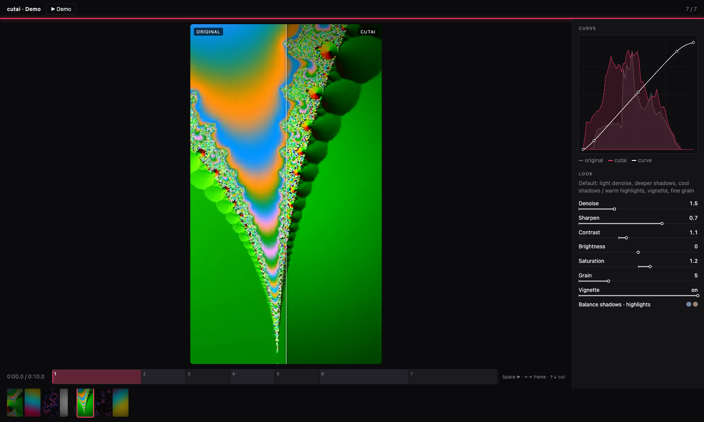

# cutai

**An AI plans the edit, cutai builds it.** Beat-synced video edits with effects and color grading – no editing software, just JSON plans, ffmpeg and Apple Vision. Made to be driven by an AI agent (e.g. Claude Code) while you watch every change live in the browser.



## What it does

- **Cuts on the beat** – BPM detection, shots defined in beats, frame-exact cuts without drift
- **Finds the action** – motion energy per clip, `"in": "auto"` picks the most active moment
- **Smart reframe** – 16:9 → 9:16, the crop follows the person (Apple Vision)
- **Effects** – person silhouette flash on cuts, zoom-through, shake, RGB split, white flash, push-in
- **Open color grading** – looks as JSON presets: denoise, sharpen, LUT (.cube), tone curve, color balance, color hold, saturation/contrast, grain, vignette, any ffmpeg filter
- **Live view** – every rendered shot as before/after wipe, curve + histogram, look controls, timeline with keyboard control
- **Look preview in seconds** – one frame per shot instead of a full render
- **Export** – finished MP4, or FCPXML for DaVinci Resolve / Final Cut Pro

Only Python standard library + ffmpeg + two small Swift helpers. macOS 14+ (Apple Vision, VideoToolbox).

## Setup

```bash
brew install ffmpeg
git clone https://github.com/FridayBull/cutai.git && cd cutai
swiftc -O segment.swift -o segment   # person / subject mask (Apple Vision)
swiftc -O people.swift -o people     # people black & white, room stays in color
python3 test_cutai.py                # self test
```

## Try it without footage

```bash
sh examples/demo.sh                  # 4 synthetic clips + 120 BPM beat -> cutai-demo/out/Demo.mp4 (~1 min)
cd cutai-demo && python3 ../cut.py view 8765
```

Open http://localhost:8765.

## Workflow

Run everything inside your project folder. Results go to `./out/`.

```bash
python3 cut.py scan /path/to/clips     # read clips + contact sheets (out/sheets)
python3 cut.py energy -                # motion per 0.2 s, for "in": "auto"
python3 cut.py beats song.wav          # BPM, first beat, loudness per bar (find the drop)
python3 reel.py plan.json --look       # fast: 1 frame per shot, before/after in the live view
python3 reel.py plan.json              # final video out/NAME.mp4 + contact sheet
python3 cut.py build plan.json         # optional: FCPXML for Resolve / Final Cut + preview
python3 cut.py view 8765               # live view on http://localhost:8765
```

## Live view

- **Before/after** – each new shot wipes from original to graded; drag the line to compare
- **Curve** – the real tone curve of the look over the luma histograms of original and result
- **Look** – every value of the current look as a line from neutral to its value; accent color follows the look
- **Timeline** – one block per shot. `Space` play/pause · `←` `→` one frame (`Shift` = 1 s) · `↑` `↓` previous/next cut · click or drag to scrub
- **Filmstrip** – click a shot to see its before/after

Cheap by design: the page polls a small `out/status.json` every 2 s (not at all in a background tab) and only loads images when they change. The server is Python's built-in `http.server`.

## Plan

Example: [`examples/reel.json`](examples/reel.json), [`examples/demo.json`](examples/demo.json). All fields are listed at the top of `reel.py`.

```json
{
 "name": "My_Reel", "song": "song.wav", "song_in": 32.5, "bpm": 128, "size": [1080, 1920],
 "look": "cinematic",
 "shots": [
  {"clip": "0545", "in": "auto", "beats": 4},
  {"clip": "0583", "in": 4, "beats": 2, "mask": "fg", "fx": ["zoom"]},
  {"clip": "0566", "in": 1.0, "beats": 2, "flash": false, "look": {"bw": true}}
 ]
}
```

| Field | Meaning |
|---|---|
| `bpm` + `beats` per shot | cuts on the beat (or `cuts`: cut times in seconds) |
| `clip` | file name without extension, or a unique part of it (`"0594"` for `DJI_..._0594_D.MP4`) |
| `in` | start second in the clip, or `"auto"` (most motion) |
| `frame` | `[x, y, zoom]` or `"auto"` (follows the person, default for portrait) |
| `mask` | `person`, `fg` (foreground subject) or `none` – silhouette flash at the cut; `flash: false` = hard cut |
| `fx` | transition into the shot: `zoom`, `shake`, `rgb`, `flash` |
| `look` | preset name or values (see below); per shot `look` overrides single values |
| `silhouette_color`, `flash_frames` | silhouette color (default `white`) and frames per side (default 2, 0 = off) |
| `fit`, `people_bw`, `song_parts`, `fps`, `fade` | full frame on blurred background, desaturate people only, build song from parts, frame rate, audio fade |

## Looks

A look = preset from `looks/` + your own values. A new preset is just a new JSON file in `looks/`.

```json
"look": {"preset": "neutral", "lut": "~/LUTs/film.cube", "contrast": 1.15, "accent": "#ffb000"}
```

| Field | Effect | neutral |
|---|---|---|
| `denoise` | noise reduction (hqdn3d) | 0 |
| `sharpen` | sharpening (cas, 0–1) | 0 |
| `lut` | .cube file, e.g. exported from DaVinci Resolve | – |
| `curve` | tone curve, points `[[in, out], …]` 0–1 | `[[0,0],[1,1]]` |
| `shadows`, `highlights` | color balance `[r, g, b]`, each −1…1 | `[0,0,0]` |
| `hold` | keep one color, rest black & white: `{"color": "#E01010", "similarity": 0.08, "blend": 0.04}` | – |
| `saturation`, `contrast`, `brightness` | eq | 1, 1, 0 |
| `filter` | any ffmpeg filter chain (after eq) | – |
| `vignette` | `true` or angle | `false` |
| `grain` | film grain | 0 |
| `bw` | black & white | `false` |
| `accent`, `note` | live view only: accent color, description | – |

Presets: `cinematic` (default), `neutral` (clean base for grading in Resolve), `bw_red` (black & white, only strong red survives).

## For AI agents

cutai is built for an agent that plans and a human who watches and gives feedback in plain words ("shot 4 shorter, less red").

1. `scan`, then look at the contact sheets in `out/sheets/` (tile k in sheet NN = second (NN−1)·60 + 2k).
2. `beats` for BPM and drops. Write the plan as JSON.
3. Change the look with `reel.py plan.json --look` first (seconds), then render the full video.
4. Check `out/NAME_sheet.jpg`, adjust the plan, render again. Shot numbers in the live view match the plan.

Notes: on 8 GB Macs close heavy apps (e.g. Resolve) while rendering. Code comments are in German.

## License

MIT – see [LICENSE](LICENSE).
